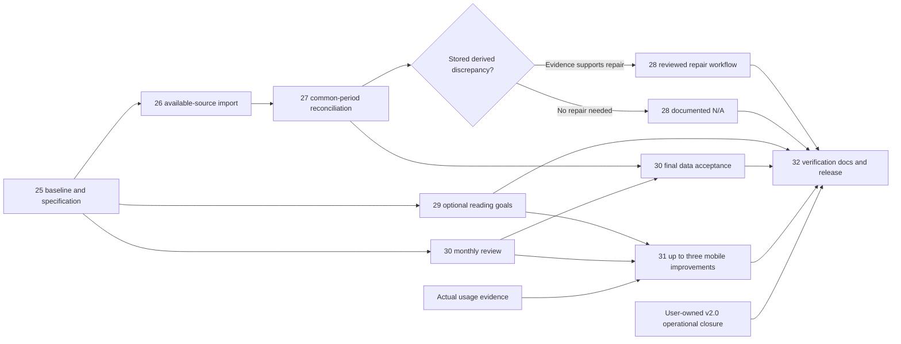

# v2.1 concrete backlog — Tasks 26–32

Baseline and confidence: [Task 25 report](task-25-baseline.md). These are future work packages, not work started by Task 25. Task 25 documents/specification are reviewable; production preflight and product proposals remain explicit review items.

| Task / status | Concrete work and acceptance | Dependency / evidence |
| --- | --- | --- |
| **26 Planned** | Inspect existing intent and independent streams; use existing full-history and library controls; monitor durable progress until available API enumeration is exhausted for sessions and metadata. Explain/resolve pending work, retain deduplication/receipts and verify subsequent incremental operation | Task 25 review plus [operator preflight](task-26-handoff.md). Do not restart an existing intent, change limits or presume pre-2026 data is unavailable |
| **27 Planned** | Reconcile raw sessions, Overview, Activity, Reports and CSV for identical local month/year periods; include DST, Monday/year boundaries, null linkage, zero durations, invalid/duplicate records and empty periods. Retain source scope and unexplained differences separately | Final result after 26; interim comparisons may be labeled provisional. Consistent snapshot or explicit concurrent-write limits; optional independent Matter/export evidence only when comparable |
| **28 Conditional** | First read-only preview. Repair only stored-derived discrepancies justified by 27; otherwise record N/A. Prepare a reviewed production workflow, backup/restore evidence, pause/abort owner, expected pointer/epoch and cutover/rollback review before execution | 27 + validated backup/restore + separately reviewed production workflow. Existing repair CLI stays isolated-only; no bypass and no presumption of a global analytics rebuild |
| **29 Planned** | Implement server-persisted, disabled-by-default weekly/yearly goals, unique per calendar period; guarded create/edit/disable; period isolation and Overview values/pacing. Select storage/migration in its own PR; test persistence, concurrent uniqueness, authorization, DST and period rollover risks | Task 25 product proposals reviewed. Development may proceed in isolation alongside 26–27; no personal target selected here |
| **30 Planned** | Extend monthly Reports with time/active-day, daily resolution, selected-year trend and deterministic observations. Keep existing totals, period/reference navigation, annual recap and CSV. Verify formula/zero/missing-data/year-boundary cases | Task 25 spec; implementation can proceed in isolation; final acceptance uses 27 data reconciliation |
| **31 Planned** | Gather 1–2 weeks of practical usage findings, rank friction, select at most three changes, then verify touch/keyboard/reachability, light/dark, Safari/iPhone and representative desktop | Actual usage evidence plus 29–30 designs. Candidates in [spec](task-25-product-spec.md) are provisional, not commitments or a release ETA |
| **32 Planned** | Consolidate v2.1 checks with existing CI/security/DB gates; measure real-history performance before optimizing; refresh README/architecture claims; release notes, limits, audit exceptions and Craft. If a new migration exists, document migration-before-compatible-code and rollback | Acceptance of 26–31 or justified N/A/defer of optional mobile items and N/A of 28; **v2.0 operational closure owned by user**. Release/deploy only under its authorized workflow |

## Import, reconciliation and repair are separate

Task 26 adds available source data without changing source semantics. Task 27 identifies differences for the same raw input, timezone and boundaries; neither empty months nor missing linkage alone proves data loss. Canonical raw-session analytics do not require a repair merely because stored estimates have unknown provenance.

Activate Task 28 only with a documented discrepancy in a consumed stored-derived field, its scope/method/timezone, read-only Task 19 preview (including invalid/missing-baseline outcomes), and evidence that raw analytics are understood. Then require an appropriate production tool/workflow (the Task 20 CLI rejects production), a verified actual backup plus isolated restore rehearsal, compatible reader/writer inventory and pause plan, reviewed candidate reconciliation, exact expected active generation/epoch, explicit cutover review and rollback/abort ownership. Preserve raw timestamps/durations/IDs, receipts, checkpoints and dirty revisions. Task 25 executed none of these changes.

## Outstanding decisions and blockers

Review proposed goal lifecycle/input/pacing and monthly-review rules in the spec. Choose a personal target only when the user elects to create a goal. Mobile selection awaits usage evidence. Task 26 needs refreshed private state and verification of deployed SHA, configuration, full migration/function/ACL chain and suitable operational sync checks. Green CI and a readable production database do not close those gates.

The user continues post-merge artifact/cleanup review, actual hosted staging, deployed identity/settings/migrations, login/core-screen checks, two actual scheduled cron cycles and production backup/restore evidence. Task 25 does not change their status or ownership.
